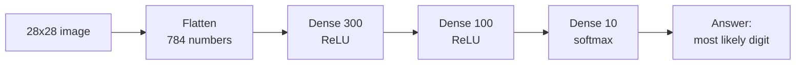
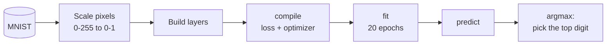
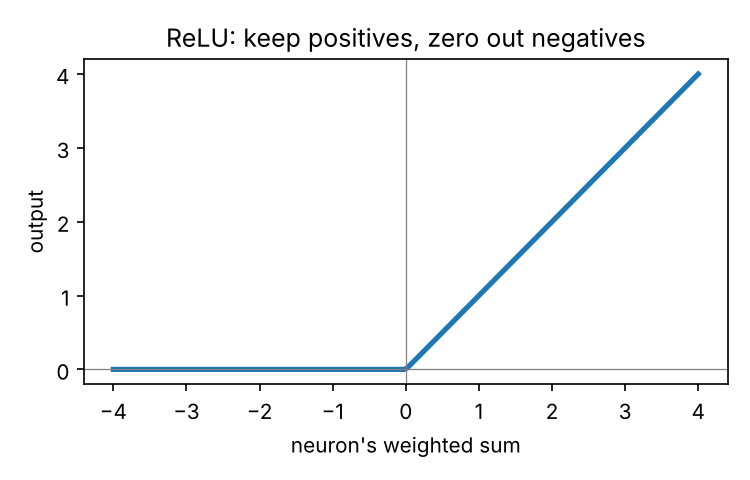
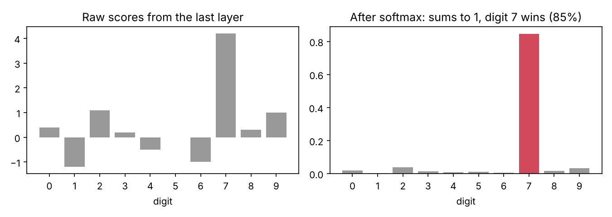
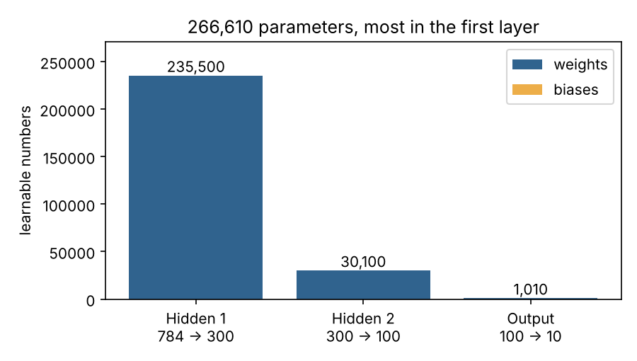

# Handwritten Digit Neural Network

Teaching a computer to **read handwritten digits** (0 to 9) with a small neural network built in Keras.
Explained for developers who have never touched ML. If you can write a function, you can follow this.

| 70,000 | 784 | 266,610 | 10 |
|:-:|:-:|:-:|:-:|
| handwritten digits | pixels per image | learnable parameters | possible answers |

<sub>Data: the MNIST database of handwritten digits [[1]](#references), bundled with Keras. Model based on Géron's *Hands-On Machine Learning* [[2]](#references).</sub>

---

## A neural network in one picture

An image goes in as numbers. Each layer turns those numbers into slightly more useful numbers. The last layer gives one probability per digit, and the highest one is the answer.



## Translation table: ML words for developers

| ML term | What it means in dev terms |
|---|---|
| **Neuron** | A tiny function: weighted sum of its inputs, then an activation |
| **Layer** | An array of neurons that all read the same inputs |
| **Dense layer** | Every neuron connects to every output of the layer before |
| **Weight** | A number the network tunes; how much one input matters |
| **Bias** | A per-neuron offset, like the `b0` in a straight line |
| **Activation function** | A small non-linear function applied after the weighted sum |
| **Loss** | One number scoring how wrong the predictions are |
| **Epoch** | One full pass over every training image |
| **Optimizer** | The algorithm that nudges weights to lower the loss (here, SGD) |

## The whole workflow



In code, the whole model is five lines:

```python
model = keras.Sequential([
    keras.Input(shape=(28, 28)),
    keras.layers.Flatten(),
    keras.layers.Dense(300, activation="relu"),
    keras.layers.Dense(100, activation="relu"),
    keras.layers.Dense(10, activation="softmax"),
])
model.compile(loss="sparse_categorical_crossentropy", optimizer="sgd", metrics=["accuracy"])
model.fit(x_train, y_train, epochs=20)
```

---

## Core ideas

### 1. Flatten: turn a picture into a list

A computer can't see pictures, only numbers. A picture is a grid where **0 = white** and **1 = ink**. Here is a tiny 3 × 3 picture of the digit "1":

```
0  1  0
0  1  0
0  1  0
```

A dense layer can't read a grid. It needs **one long row** of numbers. `Flatten` unrolls the grid like a scarf, reading it **like a book**: left to right, top row first.

```
row 1    row 2    row 3
0 1 0    0 1 0    0 1 0

becomes:  0 1 0 0 1 0 0 1 0
```

Same numbers, same order every time, so each spot always means the same pixel (spot 1 is always the top-left corner). A smaller example:

```
1  0
0  1      →     1 0 0 1
```

MNIST pictures are 28 × 28, so flattening gives **28 × 28 = 784** numbers. Before that, every pixel is divided by 255 so values sit between 0 and 1, which keeps training stable.

### 2. ReLU: let neurons switch on and off

Without an activation function, stacking layers would still only draw straight lines. **ReLU** keeps positive values and turns negatives into 0. That small bend is what lets the network learn curves, loops and strokes.



### 3. Softmax: turn scores into a vote

The last layer has 10 neurons, one per digit. **Softmax** turns their raw scores into probabilities that are all between 0 and 1 and add up to 1. The digit with the highest probability is the prediction.



> This is multi-class classification done in one model, instead of training many yes/no models as in One-vs-Rest.

### 4. Where all the parameters live

Every connection is a weight, and every neuron has one bias. The first hidden layer connects 784 pixels to 300 neurons, so it holds almost 90% of the model.

```
first hidden layer = 784 × 300 weights + 300 biases = 235,500
```



### 5. Training: many small corrections

**Loss** measures how wrong the predictions are. **Sparse categorical cross-entropy** is the standard loss when labels are plain integers like `7`. **Stochastic gradient descent (SGD)** looks at small batches of images and nudges every weight a little in the direction that lowers the loss. One **epoch** is one full pass over the training set, and this model trains for 20.

---

## Run it yourself

```bash
python3 -m venv .venv
source .venv/bin/activate
pip install tensorflow matplotlib numpy
python train_digit_classifier.py   # downloads MNIST, trains for 20 epochs, shows predictions
python docs/make_figures.py        # regenerates the concept images in this README
```

The script prints the test accuracy on 10,000 digits the network has never seen, and plots training vs validation accuracy for each epoch.

Built with [TensorFlow / Keras](https://keras.io), [NumPy](https://numpy.org) and [matplotlib](https://matplotlib.org).

## References

1. Y. LeCun, C. Cortes and C. J. C. Burges, "The MNIST Database of Handwritten Digits," 1998.
2. A. Géron, *Hands-On Machine Learning with Scikit-Learn, Keras, and TensorFlow*, 3rd ed. O'Reilly Media, 2022. Chapter 10.
